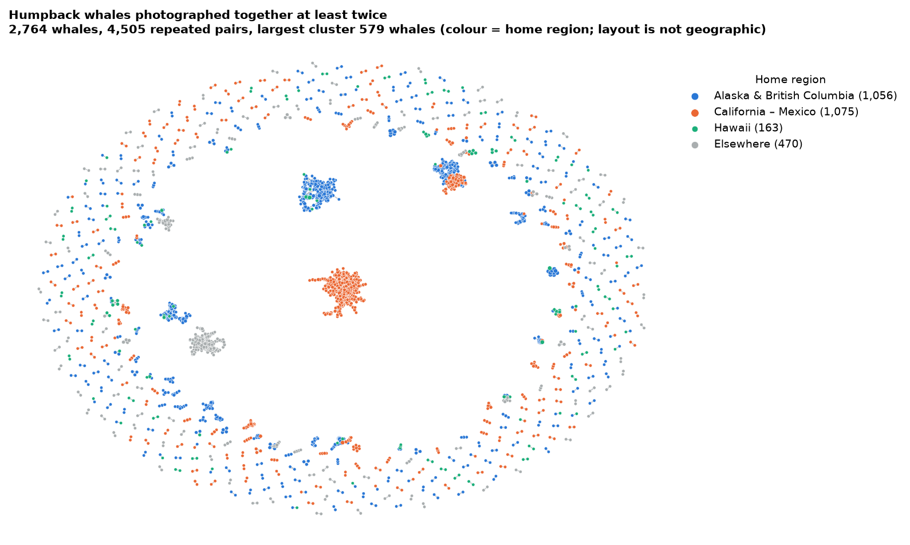
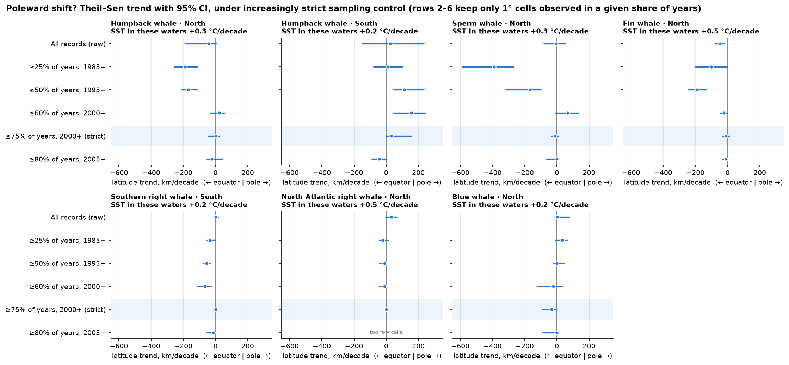

# Whale migration

Whale sightings and catches from 1784 to today, gathered from five public databases, cleaned and
merged into one dataset, plus two analyses built on it:

- **Social network:** which humpback whales are photographed together again and again?
- **Climate change:** are whales being seen closer to the poles as the ocean warms?

Species: humpback, sperm, blue, fin, North Atlantic right and southern right whales.

## Findings

**Humpback companions.** 2,764 photo-identified humpbacks were photographed together with the same
companion at least twice, forming 4,505 repeated pairs. 1,182 of those pairs met again in a different
year. The tightest groups are in Alaska and along the California–Mexico coast.



**Poleward shift.** The water where these whales are seen warmed by 0.2 to 0.5 °C per decade between
1985 and 2025. Measured naively, sighting latitudes seem to shift by hundreds of kilometres, in either
direction depending on the method. Once the analysis only uses places observed in most years, no
species shows a shift that holds up. The raw trends mostly reflect where people went looking.



All figures are in [figures/](figures/).

## Quick start

Needs Python 3.11+ and [uv](https://docs.astral.sh/uv/).

```bash
uv sync                                   # install dependencies
uv run python -m pipeline viz             # redraw the figures from results/ (seconds, no data needed)
```

To rebuild everything from the original sources (a few hours, ~3 GB in `data/`):

```bash
uv run python -m pipeline run             # fetch -> clean -> unify -> docs
uv run python -m pipeline analyze         # recompute results/*.json
uv run python -m pipeline viz             # redraw figures/*.png
```

Each stage can also be run alone, for one source: `python -m pipeline fetch obis`,
`python -m pipeline clean obis`, `python -m pipeline status`. Downloads are cached.

## How it fits together

```text
fetch → clean → unify → analyze → viz
```

| stage | does | writes |
|---|---|---|
| fetch | downloads each source | `data/raw/` |
| clean | fixes names, dates and positions per source | `data/interim/` |
| unify | merges sources and removes duplicates | `data/processed/`, `docs/` |
| analyze | answers the questions above | `results/*.json` |
| viz | draws matplotlib figures | `figures/*.png` |

`data/` is not in git (too large, and some licenses forbid redistribution). `results/` and
`figures/` are, so figures can be edited without the dataset.

## Documentation

- [docs/EXTENDING.md](docs/EXTENDING.md): **start here** to add a figure, an analysis, a species or a source
- [docs/DATA.md](docs/DATA.md): output files, every column, every cleaning rule
- [docs/DATA_SUMMARY.md](docs/DATA_SUMMARY.md): record counts per source, species and decade
- [docs/SOURCES.md](docs/SOURCES.md): licenses and citations

## Data sources and licenses

WhalingHistory.org logbooks (CC BY 4.0), OBIS, GBIF, OBIS-SEAMAP / Happywhale photo-ID (mostly
CC BY-NC), NOAA ERDDAP sea temperature (HadISST, academic use only) and chlorophyll, NSIDC sea ice,
Protected Planet marine protected areas (non-commercial, no redistribution) and IMF/World Bank
shipping density (CC BY 4.0). Records their photographers marked "No use without permission" are
excluded. Every record keeps its own license and citation; see [docs/SOURCES.md](docs/SOURCES.md).
