# Visualization showcase

Fourteen figures, each an example of a different visualization technique, made from the project's whale dataset.
No new data sources were added. Every figure states what it shows, how it was built, how to read it, and where it
can mislead.

Regenerate:

```bash
uv run python -m pipeline analyze showcase   # needs the full dataset in data/processed (~10 s)
uv run python -m pipeline viz                # redraws figures/ and showcase/figures/ from the JSON (no dataset needed)
```

| file | content |
|---|---|
| `src/pipeline/analysis/showcase.py` | turns the dataset into one small table per figure |
| `showcase/results/showcase.json` | those tables (421 KB, small enough to commit, so figures can be redrawn without the data) |
| `src/pipeline/viz/showcase.py` | the plotting code, one function per figure |
| `src/pipeline/viz/style.py` | colours shared with the project's other figures |

## The project in brief

The pipeline downloads whale records from public databases, cleans them into one table, removes records that
appear in several databases, and runs analyses on the result.

- **Final dataset:** 1,129,602 records of six species, 1723–2026: humpback (581,171), fin (295,811), sperm
  (159,167), southern right (39,906), blue (30,251) and North Atlantic right whale (23,296).
- **Sources that contributed:** OBIS, GBIF, OBIS-SEAMAP (mostly Happywhale photo-ID) and the American Offshore
  Whaling Logbooks. Movebank needs an account and was skipped.
- **Kinds of record:** whaling catches, visual sightings, acoustic detections, photo-ID encounters of a known
  individual, and satellite-tag positions. They measure different things and are rarely comparable (Figure 7).
- **Environmental layers:** monthly sea temperature (HadISST, 1°), chlorophyll (ESA OC-CCI, 1°), sea ice, ship
  traffic density (AIS 2015–2021, 0.1°) and 17,250 marine protected areas (WDPA).
- **Logbook effort table:** 468,249 vessel-days of American sailing whalers, 1784–1920, including days when no
  whale was seen. It is the only place where search effort is known, which makes rates possible (Figure 6).

### Things that affect every figure

- **Records follow observers, not whales.** A dense area means many people looked there. Where possible the
  figures divide by effort or normalise per month, and say so.
- **Acoustic detections are excluded** from all figures except Figure 7. One hydrophone array off Kauai supplies
  184,000 fin whale detections, 62% of all fin whale records. Left in, it makes fin whales look like a warm-water
  species with a median of 24.5 °C. Without it the median is 16 °C.
- **Shared record filter** (called `VISUAL` in the code): visual sightings and photo-ID encounters, no acoustic
  detections, position known to within 60 km.
- **Samples:** Figures 8, 9 and 11 use up to 20,000 records per species. The sample is the same on every run
  (records ordered by a hash of their ID), so the numbers in this report are reproducible.
- **Maps use plain longitude/latitude.** No map-projection library is installed. A 2° cell at 60° latitude covers
  half the area of one at 20°, so count maps understate high latitudes.
- **Known gaps:** GBIF records without a year could not be fetched (23% of GBIF sperm and southern right whale
  records). OBIS records without a date are also missing.

---

## 1. Seasonal migration as a latitude × month heatmap

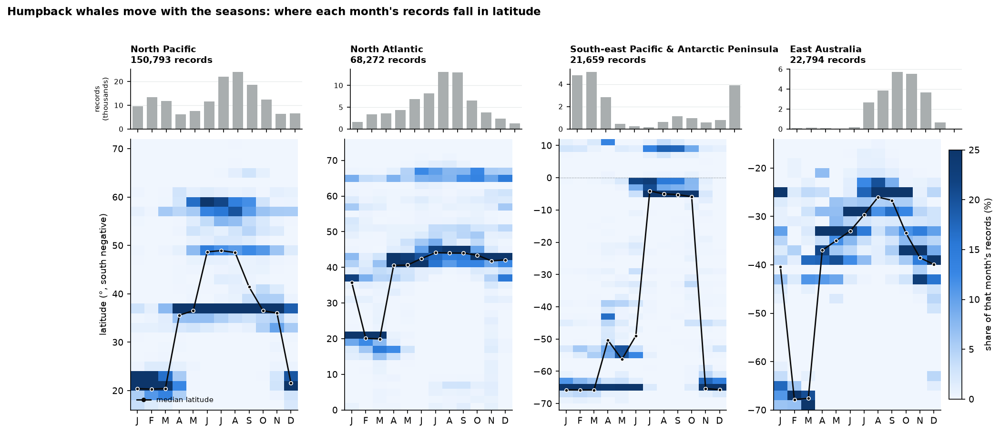

**Technique.** Heatmap with time on one axis and space (latitude) on the other, plus a small bar chart on the
same time axis. One panel per population (small multiples).

**What it shows.** In which latitudes each month's humpback records fall, for four populations.

**How it was made.** Humpback sightings and photo-ID encounters, 1990–2025, with a known day or month, split into
four populations by longitude boxes. Records are counted per 2° latitude band and month. Each column is then
divided by that month's total, so every month sums to 100%. The black line is the median latitude per month.
The grey bars on top show how many records each month has.

| population | records | Jan–Mar median | Jul–Sep median |
|---|---|---|---|
| North Pacific | 150,793 | 21°N (Hawaii, Mexico) | 49°N (Alaska, British Columbia) |
| North Atlantic | 68,272 | 21°N in Feb–Mar (West Indies) | 45°N (Gulf of Maine) |
| South-east Pacific & Antarctic Peninsula | 21,659 | 65°S (Antarctic Peninsula) | 3–5°S (Ecuador, Colombia) |
| East Australia | 22,794 | 67°S in Feb–Mar (Antarctic waters) | 25°S (Queensland) |

**How to read it.** Dark cells mark where most of that month's records are. The line jumping between high and
low latitudes is the migration. Northern populations feed at high latitudes in the northern summer, while
southern populations do so in the southern summer, so the patterns are mirror images. In East Australia the
in-between months (Apr–Jun, Oct–Dec) sit at 33–39°S. That is the migration corridor along the New South Wales
coast.

**Why normalise per month.** Raw counts would mostly show the whale-watching season (see the July–August peak in
the grey bars). Normalising asks where whales are seen in a given month, which separates location from effort.

**Caveats.** Months with few records are noisy. The North Atlantic January median of 37°N rests on 1,600
records, and the South-east Pacific has only a few hundred records in June–July. Normalising removes effort
differences between months, but not within a month: if only one region has observers in May, May looks like that
region.

## 2. The same migration as monthly small-multiple maps

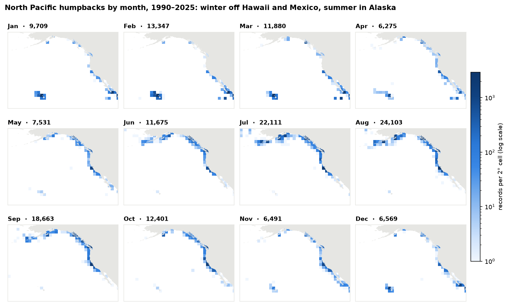

**Technique.** Small multiples: twelve identical maps, one per month, with one shared colour scale.

**What it shows.** Where North Pacific humpbacks are recorded in each month (same records as Figure 1).

**How it was made.** Records counted in 2° cells, shown on a log colour scale shared by all panels. The number
next to each month is its record total. Land is drawn above the cells so that islands such as Hawaii stay
visible.

**How to read it.** Compare panels left to right, top to bottom. The Hawaii cluster appears from December to
April and nearly vanishes in summer. The Gulf of Alaska and the Bering Sea fill in from May to October. The
California coast has records all year, because it is both a feeding area and a migration route.

**Trade-off against Figure 1.** Figure 1 compresses geography into one number (latitude) and shows all months
at once. This figure keeps the geography but needs twelve panels and makes month-to-month comparison harder.
The log scale lets sparse areas show at all, but makes the difference between busy and quiet cells look smaller
than it is.

## 3. Photo-ID connectivity as a flow map

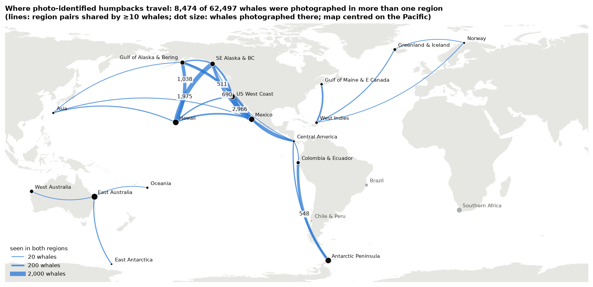

**Technique.** Flow map: curved lines between places, with width proportional to the number of individuals.

**What it shows.** Which feeding and breeding regions are linked by the same individual whales.

**How it was made.** Happywhale photo-ID encounters of humpbacks were assigned to 20 hand-drawn regions (boxes
in the code, following the populations named in photo-ID studies). For every whale, the set of regions it was
photographed in was collected, and each pair of regions was counted once per whale. Lines show pairs shared by at
least 10 whales (26 pairs; 11 smaller pairs are left out). Dots sit at the median position of the region's
encounters, sized by the number of whales photographed there. The map is centred on the Pacific so that
Asia–Alaska links do not wrap around the edge.

**Numbers.** 62,497 whales were photographed in at least one region, and 8,474 of them in two or more.

| region pair | whales seen in both |
|---|---|
| Mexico – US West Coast | 2,966 |
| Hawaii – SE Alaska & British Columbia | 1,975 |
| Gulf of Alaska & Bering – Hawaii | 1,038 |
| Mexico – SE Alaska & British Columbia | 690 |
| Antarctic Peninsula – Colombia & Ecuador | 548 |

Rare long links exist too: Asia–Hawaii (41 whales), Greenland & Iceland–West Indies (34), Asia–Mexico (21) and
Norway–West Indies (12).

**How to read it.** A thick line means many individuals were identified at both ends. The Antarctic Peninsula ↔
Colombia link is the same route the tagged whales in Figure 5 take.

**Caveats.** A line needs photographers at both ends, so it measures shared observation as much as movement.
Lines do not show direction, timing or the actual path. Brazil, Chile & Peru and Southern Africa have no links:
their feeding grounds in the Atlantic and Indian Ocean sectors of the Antarctic fall outside the boxes and are
rarely photographed.

## 4. Individual life histories as a timeline

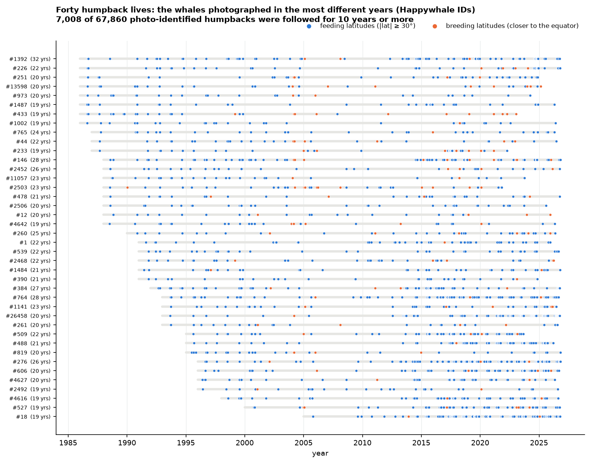

**Technique.** Event timeline: one row per individual, one dot per observation.

**What it shows.** The 40 humpbacks photographed in the most different years, 19 to 32 years each.

**How it was made.** Every photo-ID encounter of each whale is a dot at its exact date. Colour shows the latitude
of the sighting: blue at feeding latitudes (30° or more from the equator), orange at breeding latitudes. The grey
bar runs from first to last sighting. Rows are sorted by the year first seen.

**Numbers.** 7,008 of 67,860 photo-identified humpbacks were seen across 10 years or more. Whale #1392 was
photographed 159 times in 32 different years, from 1986 to 2026.

**How to read it.** Each row is one animal's documented life. Orange dots between blue ones mark breeding trips.
They are rare (3% of #1392's sightings), because most photographs are taken on feeding grounds near
whale-watching ports.

**Caveats.** The dense dots after 2015 and the thin stretch around 2006–2012 most likely reflect when photo
catalogues were uploaded to Happywhale, not when whales were present. The 30° line is a simple rule: it puts Hawaii (20°N) and
Mexico in breeding and California (35°N) in feeding, which fits the North Pacific but is crude elsewhere.

## 5. Tag tracks as a space-time cube

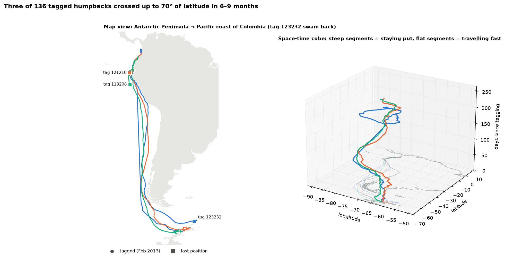

**Technique.** Space-time cube: longitude and latitude on the floor, time as height. A flat map is drawn beside
it for reading positions.

**What it shows.** The three tagged humpbacks with the largest north–south range, among the 136 tagged humpbacks
in the data.

**How it was made.** Satellite-tag positions from the Antarctic tracking compilation by Ropert-Coudert et al.
(via OBIS). That dataset carries no animal ID, so tracks were separated by the tag's device number in the
`platform` field. Positions were reduced to one median position per day to smooth Argos location noise. The
three tracks with the largest latitude span were kept.

**What the tracks say.** All three were tagged on 5–8 February 2013 near the Antarctic Peninsula.

- They stayed in Antarctic waters for 85–97 days, through the end of the southern summer.
- They then reached 10°S within about 40 days, moving up to about 170 km per day over 10-day stretches.
- They spent about 25 days north of the equator, reaching 2–5°N off Colombia.
- Tags 121210 and 113208 last transmitted off Ecuador and Peru on days 195–198.
- Tag 123232 turned back and was at 61°S, near the South Shetland Islands, on day 265.

**How to read it.** In the cube, steep segments mean time passes while the whale stays in one place (feeding
near the Peninsula, breeding off Colombia). Flat segments mean fast travel. The faint lines on the floor are the
same tracks seen from above.

**Caveats.** A 3D chart printed on paper cannot be rotated, and perspective makes values hard to read, which is
why the flat map is shown next to it. Three whales are a showcase, not a sample.

## 6. Whaling encounter rate as effort-normalised maps

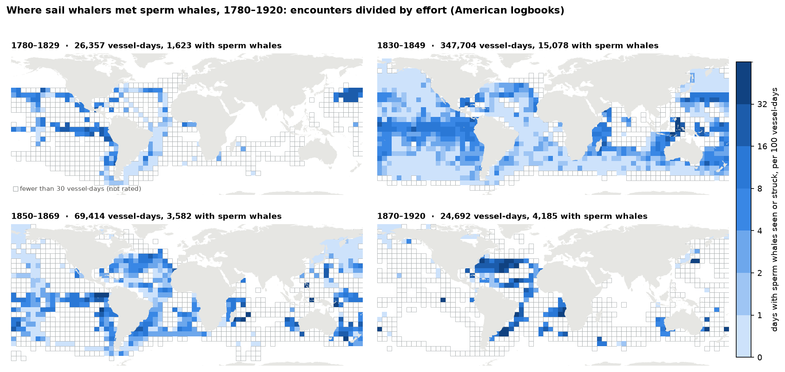

**Technique.** Choropleth on a regular grid, normalised by effort, in four small multiples (one per era).

**What it shows.** How often sailing whalers met sperm whales, per 100 days at sea, in 5° cells.

**How it was made.** From the logbook effort table: every vessel-day with a position, excluding position errors
the cleaning step could not fix. A vessel-day counts as a sperm whale day when the logbook records sperm whales
seen or struck. Rate = sperm whale days ÷ vessel-days × 100 per cell. Cells with fewer than 30 vessel-days are
outlined but not rated.

| era | vessel-days | sperm whale days | overall rate per 100 days |
|---|---|---|---|
| 1780–1829 | 26,357 | 1,623 | 6.2 |
| 1830–1849 | 347,704 | 15,078 | 4.3 |
| 1850–1869 | 69,414 | 3,582 | 5.2 |
| 1870–1920 | 24,692 | 4,185 | 16.9 |

**How to read it.** Dark cells are where a day at sea most often produced a sperm whale encounter. Outlined cells
show where ships went but too rarely to rate. Comparing the panels shows the fleet's range expanding into the
whole Pacific and Indian Ocean in the 1830s–1840s. In 1830–1869 the highest rates sit in the western Pacific and
the Indonesian seas. After 1870 the fleet shrinks to the Atlantic.

**Why divide by effort.** A map of catches alone would show where ships sailed. 74% of all logged vessel-days
fall in 1830–1849, so that era would dominate any raw map.

**Caveats.** Days logged only as "whale" (21,343) are excluded, so rates are minimums. The 1870–1920 rate rests
on only 163 rated cells, and the later logbooks may record different things, so its higher value should not be
read as more whales. A rate counts days with an encounter, not whales.

## 7. Record types over 240 years as a stacked area chart

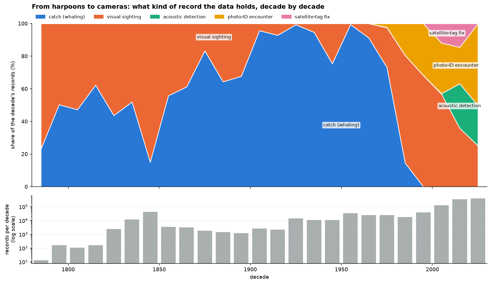

**Technique.** 100% stacked area chart for composition, with a separate log-scale bar chart for totals on the
same time axis. Two panels instead of a dual axis, so each has one scale.

**What it shows.** What kind of record each decade contributes, and how many records there are.

**How it was made.** All 1,129,602 records counted by decade and kind. Sightings flagged as acoustic are shown
as their own kind.

**How to read it.** The data changes instrument over time:

- **Sail era (1780s–1910s):** logbook sightings and catches. The 1840s alone hold 42,000 records.
- **Modern whaling (1920s–1970s):** almost only catch records, 99% in the 1950s.
- **After whaling (1980s–1990s):** visual surveys.
- **2000s onwards:** photo-ID, satellite tags and acoustic arrays. In the 2020s, half of all records are photo-ID
  encounters.

The bars show that the last two decades hold most of the data.

**Why it matters for analysis.** A trend that spans eras compares catches with photographs. This is why the
climate analysis starts in 1985 and controls for sampling.

**Caveats.** The 2020s decade is incomplete (2020–2026). The tag fixes are concentrated in a handful of studies.

## 8. Temperature niche as a ridgeline plot

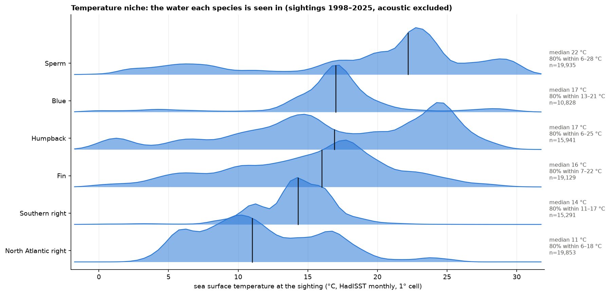

**Technique.** Ridgeline plot: one smoothed distribution per row, overlapping slightly, sorted by median.

**What it shows.** The sea surface temperature where each species is seen.

**How it was made.** Up to 20,000 records per species (shared filter, 1998–2025, known day or month). Each record
was matched to the HadISST monthly temperature of its 1° cell and month. Histograms in 0.5 °C bins were smoothed
and each curve scaled to its own peak. Black ticks mark medians.

| species | median | 80% of sightings within |
|---|---|---|
| North Atlantic right | 11 °C | 6–18 °C |
| Southern right | 14 °C | 11–17 °C |
| Fin | 16 °C | 7–22 °C |
| Humpback | 17 °C | 6–25 °C |
| Blue | 17 °C | 13–21 °C |
| Sperm | 22 °C | 6–28 °C |

**How to read it.** Narrow ridges are specialists, such as southern right whales. Wide or double-peaked ridges are
species seen in very different water. Humpbacks have two peaks: cold feeding grounds and warm breeding grounds
around 24–25 °C.

**Caveats.** Curves are scaled to their own peak, so heights compare shapes, not numbers of records. Coastal
records often fall in 1° cells that HadISST treats as land. 20% of the humpback sample has no temperature, so
coastal sightings are under-represented. Surface temperature on a monthly 1° grid is a coarse description of the
water a whale is in.

## 9. Temperature × chlorophyll niche as density contours

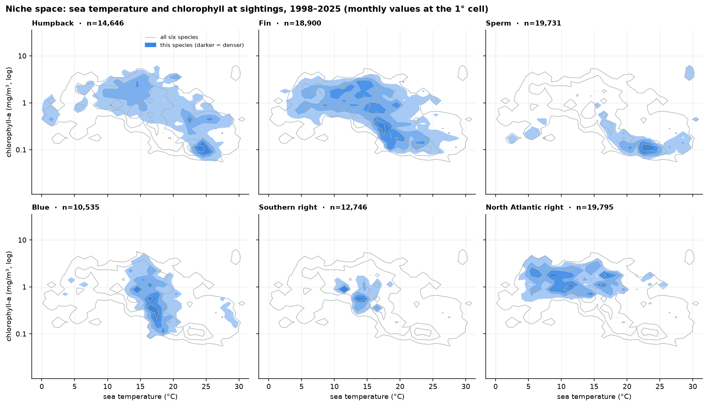

**Technique.** Two-dimensional density as filled contours, in small multiples, with a shared grey reference.

**What it shows.** Where each species sits in the space of water temperature and productivity (chlorophyll).

**How it was made.** Same sample as Figure 8, with monthly chlorophyll-a (ESA OC-CCI, 1°) added; the satellite
record starts in 1997. Records were counted in 1 °C × 0.1 log₁₀-chlorophyll bins. Filled contours show each
species' density relative to its own peak. The grey contours show the six species' normalised densities
combined, so each panel can be compared with the others.

**How to read it.** Up means more productive water, right means warmer. North Atlantic right whales stay in cold,
productive water (5–18 °C, around 1 mg/m³). Sperm whales sit in warm, clear, low-chlorophyll water (around
23 °C and 0.1 mg/m³). Humpbacks show two clusters: cool productive feeding grounds and warm clear breeding
grounds.

**Caveats.** Satellite chlorophyll has gaps under clouds and ice and overestimates in murky coastal water.
Contour levels are relative within a species, so a panel shows shape, not abundance.

## 10. Ship-strike risk as a bivariate map

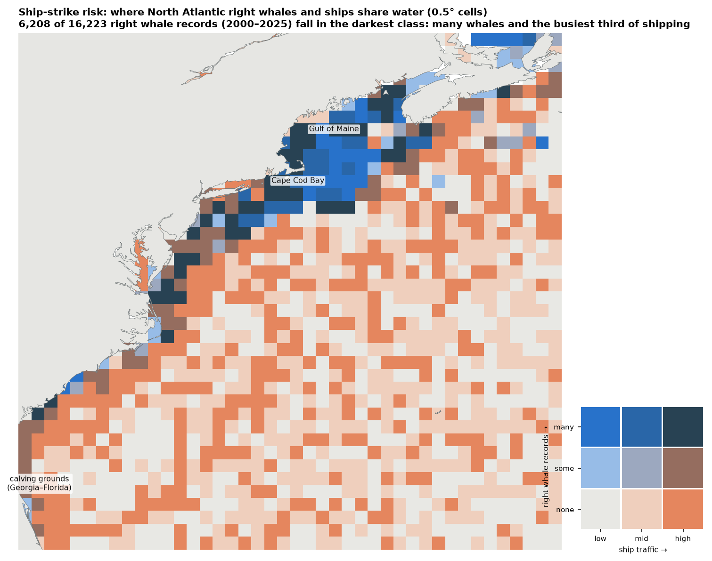

**Technique.** Bivariate choropleth: two variables in one colour, using a 3 × 3 grid of classes. Blue rises with
whale records, orange with ship traffic, and their product turns dark where both are high.

**What it shows.** Where North Atlantic right whales and ships use the same water, from Florida to Nova Scotia.

**How it was made.** Right whale records since 2000 (shared filter) were counted in 0.5° cells. Ship density
(AIS positions, 2015–2021) was averaged from 0.1° to the same cells. Only cells with ship data are drawn (1,287
cells; 55 whale records outside them are dropped). Ship traffic is split into thirds across cells. Whale records
are split into none, some (fewer than the median of 7 per occupied cell) and many.

**Numbers.** 6,208 of 16,223 right whale records (38%) fall in the darkest class: many whales and the busiest
third of shipping.

**How to read it.** Dark cells are overlap hotspots: Cape Cod Bay, the Gulf of Maine, the approaches to the
mid-Atlantic ports, and the calving grounds off Georgia and Florida. Bright blue cells have whales but little
traffic. Orange cells have traffic without recorded whales.

**Caveats.** Whale counts reflect dedicated aerial surveys, which concentrate on known habitat. Ship data covers
2015–2021, while whale records cover 2000–2025. Density counts AIS positions, not vessel speed, which is what
makes a strike lethal. Classes are relative to this region. Bivariate colour keys are hard to read at first, so
the key is drawn next to the map.

## 11. Protected-area coverage as waffle charts

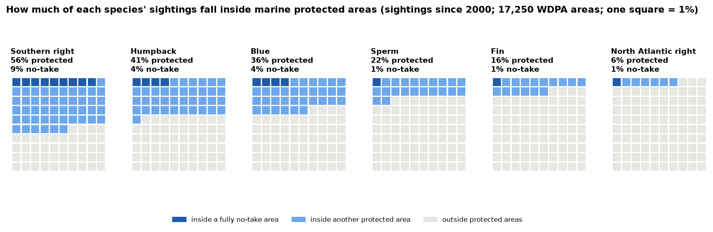

**Technique.** Waffle chart: 100 squares per species, one square = 1%.

**What it shows.** The share of each species' sightings that falls inside a marine protected area, and inside a
fully no-take area.

**How it was made.** Up to 20,000 sightings per species since 2000 (shared filter) were tested for falling inside
any of the 17,250 marine areas in the WDPA public release. Where areas overlap, a sighting counts as no-take if
any area containing it is designated fully no-take.

| species | in a protected area | of which fully no-take |
|---|---|---|
| Southern right | 56% | 9% |
| Humpback | 41% | 4% |
| Blue | 36% | 4% |
| Sperm | 22% | 1% |
| Fin | 16% | 1% |
| North Atlantic right | 6% | 1% |

**How to read it.** Darker blue squares are no-take, lighter blue are other protected areas, and grey squares are
outside. Southern right whales calve in coastal bays that are often protected. North Atlantic right whales are
mostly seen outside designated areas.

**Caveats.** These are shares of sightings, so they inherit where people watch whales. "Protected" means
designated, not effectively managed. Measures that are not designated areas, such as seasonal speed zones, are
not counted. Squares are rounded to whole percent.

## 12. Data provenance as an UpSet plot

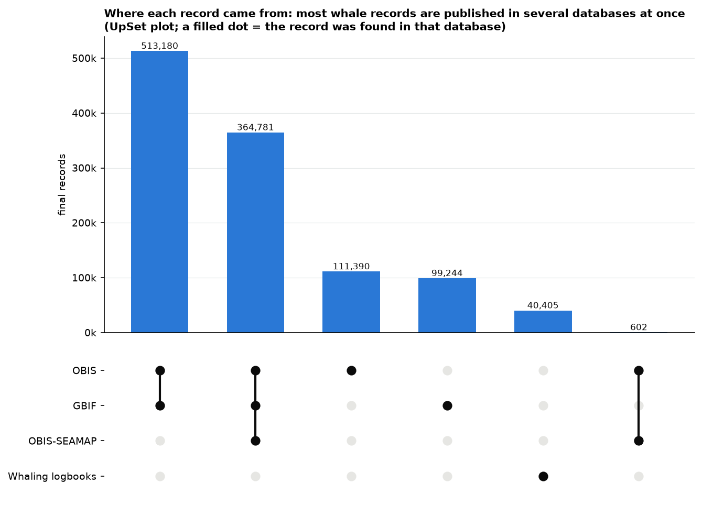

**Technique.** UpSet plot: a bar per combination of sets, with a dot matrix below showing which sets make up each
combination. It replaces a Venn diagram, which becomes unreadable beyond three sets.

**What it shows.** In which databases each final record was found.

**How it was made.** From the `merged_sources` column of the final dataset, which lists every source a record was
found in before duplicates were merged.

| found in | records | share |
|---|---|---|
| GBIF + OBIS | 513,180 | 45.4% |
| GBIF + OBIS + OBIS-SEAMAP | 364,781 | 32.3% |
| OBIS only | 111,390 | 9.9% |
| GBIF only | 99,244 | 8.8% |
| Whaling logbooks only | 40,405 | 3.6% |
| OBIS + OBIS-SEAMAP | 602 | 0.1% |

**How to read it.** Read a bar, then the dots below it. 78% of records were published in two or three databases,
because OBIS and GBIF republish each other's datasets and Happywhale data reaches both through OBIS-SEAMAP. The
logbooks are the only source with no overlap.

**Why it matters.** Without removing duplicates the dataset would count most sightings two or three times.

## 13. Cleaning and merging as a Sankey diagram

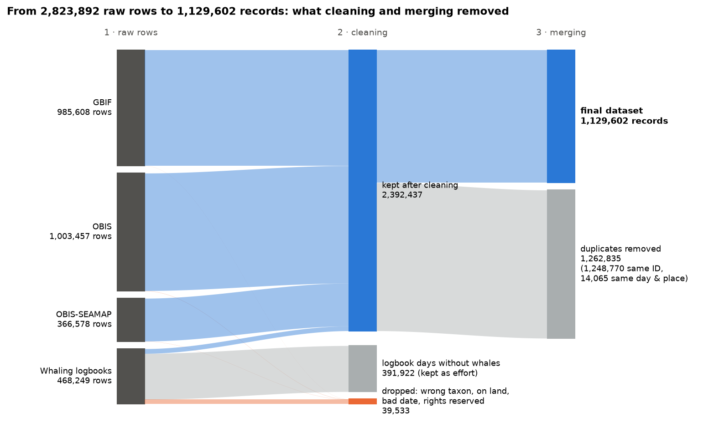

**Technique.** Sankey (flow) diagram: band width is proportional to the number of rows flowing between stages.

**What it shows.** How 2,823,892 raw rows became 1,129,602 records.

**How it was made.** From the cleaning reports (`data/interim/reports/*.json`) and the merge totals
(`data/processed/summary_totals.json`).

**The flow:**

1. **Raw rows per source:** GBIF 985,608, OBIS 1,003,457, OBIS-SEAMAP 366,578, logbooks 468,249. OBIS is counted
   after removing rows that appeared in two download windows.
2. **Cleaning kept 2,392,437 rows.**
   - 391,922 logbook days without a whale were moved to the effort table (used in Figure 6), not deleted.
   - 39,533 rows were dropped. Most were logbook entries that did not name a target species: 24,621 named only
     "whale" or a group above species level, and 11,029 named other species. Smaller drops: 2,270 records whose
     owners marked them "no use without permission", 1,356 positions on land, and 133 dates before 1700.
3. **Merging removed 1,262,835 duplicates.** 1,248,770 had the same original record ID. 14,065 were the same
   species on the same day within 2 km in different sources.

**How to read it.** Follow a band from left to right. The biggest reduction is duplication, not bad data. Records
dropped for quality are under 2% of the database rows.

**Caveats.** The merge stage is reported as a total, so the diagram does not split duplicates by source.

## 14. Distance from the coast as cumulative distribution curves

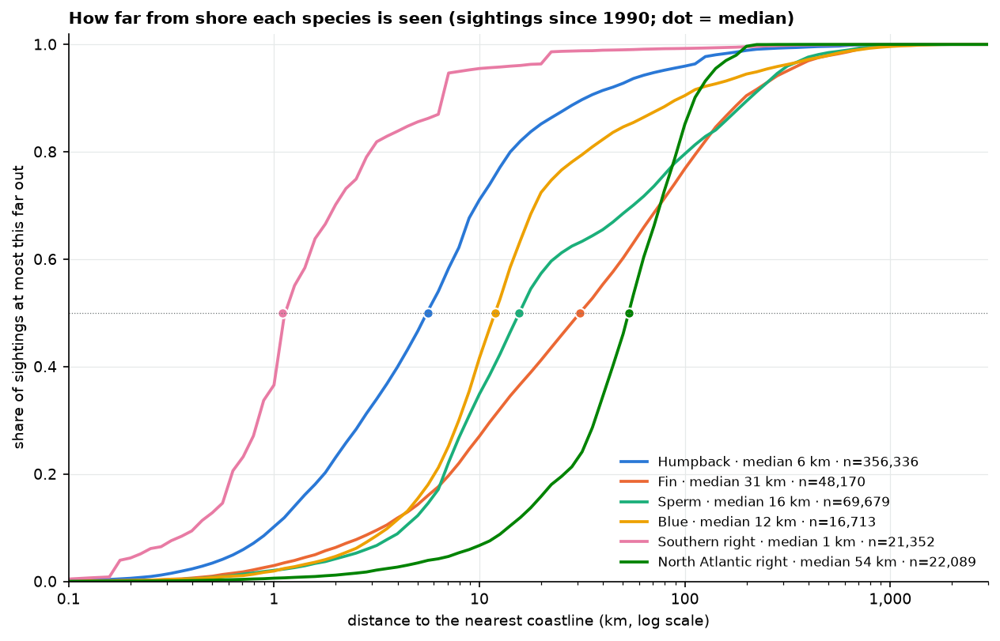

**Technique.** Empirical cumulative distribution function (ECDF) on a log axis, one line per species. It shows the
whole distribution without choosing bin sizes, and medians can be read where lines cross 0.5.

**What it shows.** How far from the nearest coastline each species is seen.

**How it was made.** All sightings and photo-ID encounters since 1990 (shared filter), using the
distance-to-coast value that cleaning computes for every record from the Natural Earth coastline.

| species | median distance | records |
|---|---|---|
| Southern right | 1 km | 21,352 |
| Humpback | 6 km | 356,336 |
| Blue | 12 km | 16,713 |
| Sperm | 16 km | 69,679 |
| Fin | 31 km | 48,170 |
| North Atlantic right | 54 km | 22,089 |

**How to read it.** A curve further left means a more coastal species. The height of a curve at a given distance
is the share of sightings at most that far out. Southern right whales are seen in shallow calving bays: 95% within
10 km. North Atlantic right whales are seen further out, on offshore banks.

**Caveats.** Whale-watching boats stay near shore, so every curve is pulled towards the coast. The sperm whale median of
16 km probably reflects places where deep water comes close to land and tourism follows, not the species'
typical habitat.

---

## Colour and design rules used

- Colours come from the project's existing palette (`viz/style.py`): blue, orange and aqua, extended with
  yellow, pink and green in a fixed order. Each species keeps the same colour wherever all six appear together.
- The six-colour order was checked with a colour-vision-deficiency validator: neighbouring colours stay
  distinguishable. Maps and scatter-like figures use at most three colours, because there every colour can sit
  next to every other.
- Three of the colours are low-contrast on white, so every chart that uses them labels its series directly or
  in the legend with their numbers.
- Magnitudes use one hue, light to dark (blue). The bivariate map adds a second one (orange).
- No chart uses two y-axes. Where two measures share a time axis, they get two panels (Figures 1 and 7).
